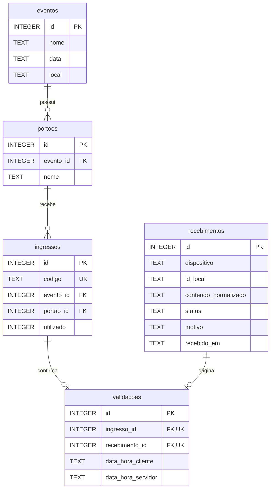

# Modelo relacional — Etapa 2

Atualização da Etapa 7: a migração aditiva `004_identidade_acesso.sql` acrescenta:

| Tabela | Chaves e finalidade |
|---|---|
| usuarios | PK id, UNIQUE usuario normalizado, senha_hash, papel, ativo, versao_token, criado_em |
| usuarios_eventos | PK (usuario_id, evento_id), FKs para usuario/evento; concede leitura do evento inteiro |
| usuarios_portoes | PK (usuario_id, evento_id, portao_id), FKs compostas para concessão de evento e portão/evento; concede sincronização |
| instalacoes | PK dispositivo, FK usuario_id, ativo, criado_em; proprietário independente do JWT e imutável por UPDATE |

Tabelas STRICT. Índices cobrem os vínculos inversos; PKs cobrem consultas de
autorização por usuário/evento/portão e instalação. Trigger incrementa a versão
do token quando login, hash, papel ou ativo mudam. Remover concessão de evento
remove somente suas concessões de portões; nenhuma tabela de negócio é apagada.
Não há contas ou credenciais no seed. Recibos continuam imutáveis e ligados ao
identificador original; a atribuição de instalações legadas não é automática.
Políticas e contratos: [contrato-autenticacao.md](contrato-autenticacao.md).

O restante preserva a documentação histórica das Etapas 2 e 5.

Este documento preserva o modelo entregue na Etapa 2. A evolução autorizada na
Etapa 5 acrescenta somente a auditoria descrita ao final; as migrações 001/002
permanecem intactas. A sincronização antes citada como futura foi implementada
conforme [relatório da Etapa 5](validacao-etapa-5.md).

Implementado em SQLite com better-sqlite3, preservando os contratos observados no
frontend. IDs de negócio são numéricos; SQL usa snake_case e os mocks usam camelCase.
O mapeamento HTTP será implementado em etapa posterior. Não há endpoints novos.



## Restrições e índices

| Componente | Garantia |
|---|---|
| Todas as entidades | PK INTEGER positiva, tabelas STRICT e campos obrigatórios NOT NULL |
| `eventos.data` | Data de calendário normalizada `YYYY-MM-DD`, sem horário |
| `portoes` | FK para eventos; par `(id, evento_id)` único para referência composta |
| `ingressos.codigo` | Único globalmente, não vazio, sem espaços nas extremidades; comparação sensível a maiúsculas, como no frontend |
| `ingressos` | FK `(portao_id, evento_id)` → `portoes(id, evento_id)`; FK adicional para eventos |
| `ingressos.utilizado` | INTEGER 0/1; deve corresponder à existência de uma confirmação |
| `recebimentos` | UNIQUE `(dispositivo, id_local)`; ambos textos obrigatórios e não vazios |
| `conteudo_normalizado` | JSON válido do tipo objeto; representa os dados apresentados, não entidades validadas |
| `status/motivo` | CONFIRMADA sem motivo; CONFLITO/REJEITADA com motivo não vazio |
| `validacoes` | UNIQUE `ingresso_id` e UNIQUE `recebimento_id`, com FKs obrigatórias |
| Horários | Texto interpretável pelo SQLite e terminado em Z; defaults do servidor em UTC |
| Referências | ON DELETE/UPDATE RESTRICT; não há exclusão em cascata |

Índices explícitos: `portoes(evento_id)`, `ingressos(evento_id, portao_id)`,
`ingressos(portao_id, evento_id)` e `validacoes(data_hora_servidor)`. As restrições
UNIQUE já criam os índices de código, identidade de recibo e confirmações únicas;
esses índices não são duplicados manualmente.

`schema_migrations` é uma sexta tabela **técnica**, com versão, nome, checksum e
horário de aplicação. Não é uma entidade do domínio de eventos.

## Confirmações e consistência

O ingresso entra no banco com `utilizado = 0`. Inserir uma linha em `validacoes`
exige um recibo com status CONFIRMADA e marca automaticamente o ingresso como usado.
Se a instrução ou a transação falhar, a marcação também é revertida. Atualizações
diretas que produzam divergência são recusadas, assim como inserir um ingresso
inicialmente usado sem sua confirmação.

Recibos e confirmações não podem ser alterados ou excluídos. A identidade de um
ingresso já confirmado (ID, código, evento e portão) também é protegida. A conexão
habilita `foreign_keys` e `recursive_triggers`, inclusive para impedir REPLACE que
tentasse substituir históricos por meio de exclusão implícita. Um administrador
com controle direto do esquema pode desabilitar/remover proteções; o modelo não
é uma barreira contra quem controla o arquivo SQLite.

Na implementação futura, recibo e confirmação devem ser inseridos dentro da mesma
transação. O banco impede validação com recibo rejeitado, mas **não exige que todo
recibo CONFIRMADA isolado já tenha uma validação**: a operação transacional futura
deve garantir esse fechamento. O seed já o garante. Não foi criado serviço de
sincronização para antecipar essa responsabilidade.

O JSON dos recebimentos não tem FK para eventos/portões/ingressos: uma rejeição
precisa poder registrar um identificador inexistente. A futura camada de serviço
deve conferir o conteúdo normalizado contra o ingresso real antes de confirmar,
incluindo igualdade de código/ID, evento/portão e permissões. JSON válido, sozinho,
não prova esses vínculos. Essa distinção evita transformar o registro de uma
rejeição em uma entrada confirmada.

O identificador declarado pelo dispositivo não autentica o operador. A unicidade
prepara a idempotência, mas não implementa comparação de payloads, reenvios ou
resolução de conflitos. Esses comportamentos continuam pendentes.

## Seed fiel aos mocks

Fonte: `frontend/src/mocks/eventos.js` e `ingressos.js`, referência `1838a5a`.
Há uma cópia em `src/db/seeds/mock-data.js`, comparada integralmente nos testes,
sem dependência do frontend durante a execução do seed.

| Entidade | Quantidade em banco novo |
|---|---|
| Eventos | 3 |
| Portões | 6 |
| Ingressos | 22 |
| Recibos sintéticos | 2 |
| Validações confirmadas sintéticas | 2 |

IDs e códigos dos ingressos não são regenerados. Apenas IDs **4 e 12** começam
utilizados. O seed insere esses ingressos disponíveis e cria os registros que
acionam a marcação; estado final idêntico aos mocks. Os outros 20 ficam disponíveis.

Metadados sintéticos, explicitamente distintos de uma operação real:

- `dispositivo = seed:frontend:1838a5a`;
- `id_local = String(id do ingresso)`;
- IDs internos de recibos/validações atribuídos pelo SQLite;
- `data_hora_cliente = NULL` e `dataHora: null` no JSON, pois o mock não traz horário;
- horário do servidor/recebimento = instante da carga, não horário de entrada física.

A carga não inventa códigos nem IDs de eventos/portões/ingressos. A ausência de
horário de leitura não deve ser preenchida com uma data de entrada inventada.

Todo o seed roda numa transação IMMEDIATE. Registros existentes idênticos são
preservados, inclusive PKs e horários. Usos posteriores permanecem confirmados.
Uma colisão de cadastro/código/recibo ou estado inicial incompatível cancela a
carga inteira. Nenhum DELETE, REPLACE ou reset de utilização é executado pelo seed.

## Migrações e operação

```sh
npm run db:migrate
npm run db:seed
```

Usar `npm.cmd` no PowerShell se a política bloquear `npm.ps1`. Migrações são
explícitas, verificadas por checksum e atômicas por lote pendente. O seed só
aceita development e não executa migrações implicitamente. Erros retornam código
de saída 1; mensagens de CLI não imprimem SQL, códigos QR ou caminhos sensíveis.

Backup anterior à aplicação local: `backups/pre-etapa2-20261017.sqlite`.
Banco entregue: `data/passcheck.sqlite`. Ambos ficam ignorados pelo Git; o banco
de desenvolvimento pode ser recriado pelos dois comandos acima em arquivo novo.
Não há script destrutivo de reversão.

Fontes técnicas: [chaves estrangeiras SQLite](https://www.sqlite.org/foreignkeys.html),
[triggers SQLite](https://www.sqlite.org/lang_createtrigger.html) e
[transações better-sqlite3](https://github.com/WiseLibs/better-sqlite3/blob/master/docs/api.md).

## Pendências para etapas autorizadas

Consultar a documentação backend atualizada original quando estiver disponível;
fechar contrato de sincronização, comparação/canonicalização de conteúdo,
autorização, limites de payload e regras de correção administrativa. Manter o
histórico original caso seja necessário registrar uma correção. As validações de
horário, dados recebidos e acesso pelo operador também pertencem à futura camada
de serviço. Não foram implementados endpoints, autenticação ou sincronização.

## Evolução da Etapa 5: auditoria durável

A migração `003_auditoria_divergencias.sql` cria `auditoria_divergencias` STRICT:

| Campo | Restrição/finalidade |
|---|---|
| `id` | PK INTEGER positiva |
| `recebimento_id` | FK obrigatória para `recebimentos`, UPDATE/DELETE RESTRICT |
| `correlacao_id` | Texto de 36 caracteres; UUID gerado no servidor por requisição |
| `motivo` | Sempre IDEMPOTENCIA_DIVERGENTE |
| `hash_original`, `hash_apresentado` | SHA-256, 64 dígitos hexadecimais minúsculos |
| `data_hora_servidor` | UTC, default SQLite; não recebido do cliente |

Relação `recebimentos 1 → N auditoria_divergencias`. Índices por recibo e por
correlação, sem unicidade que impeça registrar tentativas repetidas. Triggers
recusam UPDATE/DELETE, inclusive substituição por REPLACE com triggers recursivos
habilitados. A tabela não armazena código QR, credencial, dispositivo ou payload
novamente; a referência identifica o recibo original e os hashes comparam conteúdo.

O POST grava a auditoria na transação do item e só devolve a rejeição após commit.
Falha de auditoria reverte o item e gera erro técnico; não altera o recibo original
nem cria confirmação. Os hashes seguem a canonicalização do contrato aprovado.
Recibo CONFIRMADA e validação também são gravados na mesma transação pelo serviço.
