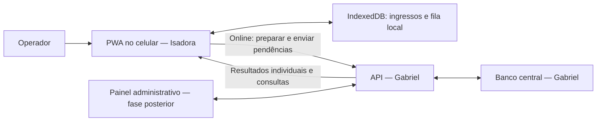
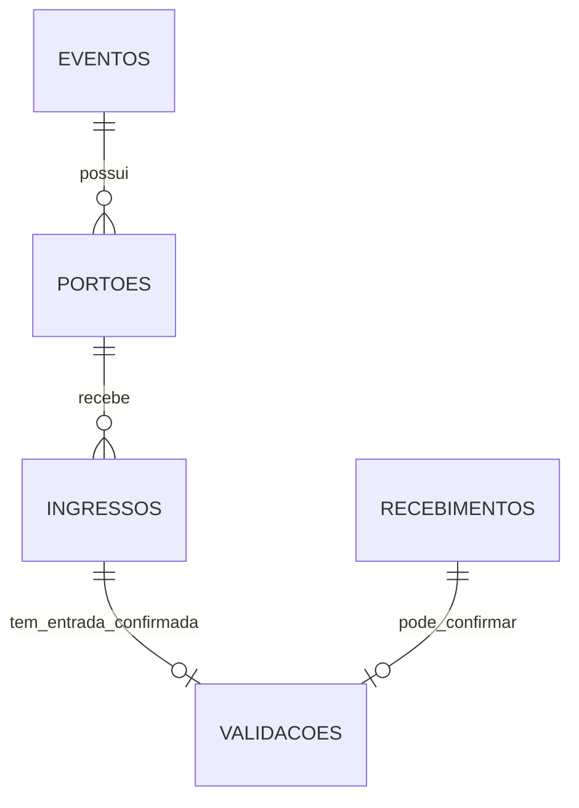
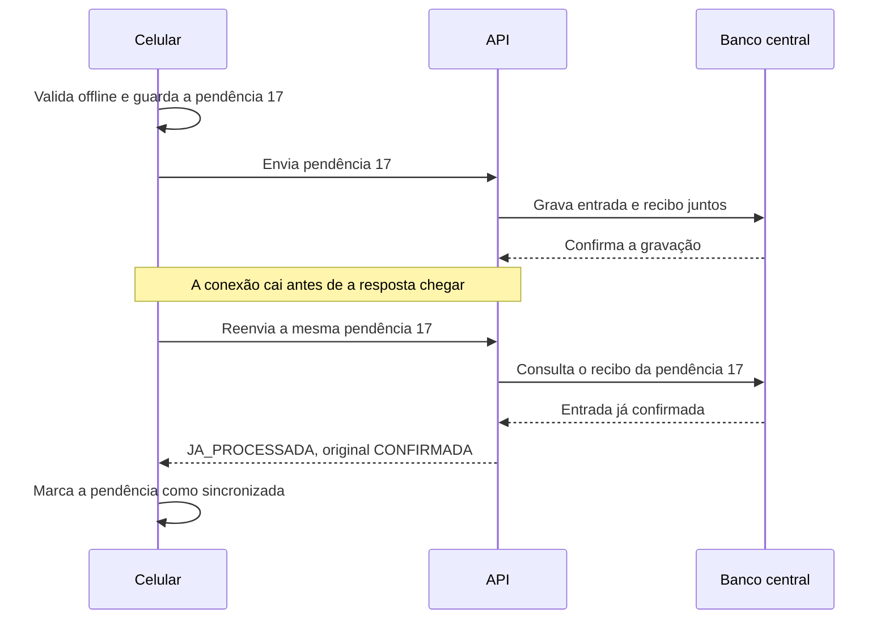

# PassCheck — Plano de ação para desenvolver o backend

Documento para estudo, implementação e discussão em equipe • 14/10/2026

**Responsável pelo backend:** Gabriel. **Responsável pelo frontend:** Isadora. **Documentação e pesquisa:** Álefe.

**Situação deste plano:** proposta técnica baseada no repositório e nas duas documentações fornecidas. Não representa aprovação de mudanças de escopo, nem afirma que o frontend esteja concluído.

## 1. Por onde começar

O backend será a central do PassCheck: guardará os eventos e ingressos, fornecerá os dados para preparar os celulares e reunirá os registros de entrada quando houver conexão. O celular continuará tomando a decisão de leitura offline.

Minha recomendação é desenvolver em entregas pequenas: **banco de dados → consultas → sincronização confiável → resumo do evento → autenticação e administração → integração e validação**. Você pode testar quase todo esse trabalho sem esperar pelas telas da Isadora, usando requisições HTTP e dados fictícios.

Há uma decisão anterior à implementação: o documento acadêmico prevê NestJS e PostgreSQL, enquanto o guia atualizado sugere Express e SQLite. Para o protótipo acadêmico com uma única instância da API, recomendo a segunda alternativa pela menor quantidade de configuração. Essa é uma proposta para a equipe confirmar; se NestJS/PostgreSQL forem exigências da disciplina, devemos manter essa stack. As regras de negócio deste plano servem para ambas.

O primeiro resultado que vale demonstrar é simples: consultar os eventos e os ingressos de cada portão, enviar uma entrada simulada e comprovar que ela não é contada duas vezes quando reenviada.

### As primeiras cinco tarefas de Gabriel

1. Registrar com a equipe a stack escolhida e quais requisitos acadêmicos entram nesta entrega.
2. Criar a estrutura do backend, a configuração local e um banco de teste separado.
3. Criar as tabelas e carregar os mesmos dados fictícios dos mocks do projeto.
4. Implementar e testar os três endpoints de consulta já descritos no guia.
5. Fechar com Isadora o formato da sincronização antes de ligar esse fluxo às telas.

## 2. O que foi analisado e o que podemos afirmar

Foram lidos o repositório local `PassCheck`, o documento `PassCheck_PEI_IV (1).docx` e o guia `PassCheck_Documentacao_Backend_Atualizada.md`, versão 0.2. A referência Git da leitura foi `1838a5a`. A árvore de trabalho estava sem alterações informadas pelo Git antes da criação deste documento.

A análise foi estática: leitura dos arquivos. Não foram instaladas dependências, iniciados serviços, executados testes do aplicativo ou alterados código, banco e configurações. As instruções contidas nos documentos foram tratadas como conteúdo a comparar com o pedido e com o código; seus exemplos de comandos não foram executados.

**“Há código” não significa “está pronto”.** A existência de uma implementação indica um ponto de partida; o funcionamento completo precisa ser demonstrado por testes, especialmente no celular.

| Parte | Evidência no repositório | Consequência para o plano |
|---|---|---|
| Backend | `backend/` contém somente `.gitkeep` | A API, o banco, as migrações e os testes ainda precisam ser criados. |
| Acesso a dados | `frontend/src/api.js:6–30` importa mocks e oferece três funções de leitura | Não existe integração HTTP implementada nesse arquivo. Manter seus formatos facilita o trabalho posterior. |
| Preparação | `screens/preparacao.js:138` percorre todos os portões do evento | Cada GET de ingressos deve filtrar o portão solicitado; a soma das consultas prepara o evento completo. |
| Banco local | `db.js:40` cria a fila com `id` numérico automático; `db.js:190` grava a pendência | Já podemos propor um mapeamento concreto para a sincronização, sem presumir que ela esteja feita. |
| Validação local | `db.js`, função `registrarValidacao`, grava utilização e pendência na mesma transação | Há uma proteção local implementada em código, que ainda exige validação em execução. |
| Scanner | `screens/scanner.js` usa `html5-qrcode`, chama o banco local e mantém controles de simulação | Existe implementação parcial; ela não demonstra conclusão do frontend. |
| PWA | `pwa.js:6–10`, `service-worker.js` e `vite.config.js:20` implementam registro e geração do cache | A afirmação do guia de que o Service Worker ainda precisa ser implementado está desatualizada para esta cópia. O comportamento offline segue sem teste nesta análise. |
| Login | `screens/login.js:30` apenas muda a tela | Não há autenticação real. |
| Dashboard | `screens/dashboard.js:13–16` mostra espaços reservados | Não há consulta ao resumo do servidor. |
| Sincronização | Não há função de envio em `api.js` nem tratamento de resultados da fila em `db.js` | O contrato e a implementação ainda são trabalho pendente de ambas as partes. |

Os mocks têm **3 eventos, 6 portões e 22 ingressos**, dos quais 2 começam utilizados. São exemplos de desenvolvimento; suas datas não são prazos de entrega do projeto.

## 3. Diferenças entre as documentações

O documento acadêmico descreve uma visão mais ampla do produto. O guia atualizado organiza um MVP menor. Nenhum deles deve ser usado para declarar funcionalidades concluídas sem evidência.

| Assunto | Documento acadêmico | Guia atualizado / código observado | Encaminhamento proposto |
|---|---|---|---|
| Frontend | React, Workbox e Barcode Detection/jsQR | JavaScript sem framework, Vite, Service Worker próprio e `html5-qrcode` | Documentar a tecnologia realmente utilizada. Implementação do frontend permanece com Isadora. |
| Backend e banco | Node.js + NestJS + PostgreSQL | Guia sugere Node.js + Express + SQLite; backend vazio | Decidir antes de criar o projeto. Recomendo Express/SQLite para a demonstração com uma API. |
| Criptografia | Base local criptografada e ingressos assinados; RNF003 | Código local armazena objetos diretamente; QR contém um código simples | Não declarar RNF003 atendido. Alinhar eventual adiamento com equipe/orientador ou abrir entrega específica. |
| Administração | Cadastro de eventos e importação CSV fazem parte do produto | Guia deixa administração para depois do operador | Seeds permitem desenvolver; não substituem cadastro e importação na entrega acadêmica se estes continuarem obrigatórios. |
| Atualização entre aparelhos | Enviar validações e receber alterações dos demais portões | Guia detalha POST e preparação, sem contrato incremental de recebimento | Propor atualização por consultas após sincronizar; separar isso de atualizações contínuas. |
| Sincronização automática | Background Sync e WebSocket/HTTP | Não implementada no código inspecionado | Começar pelo POST confiável; Isadora define os gatilhos de envio e as alternativas por navegador. |
| Estados da leitura | “Não sincronizado” aparece entre quatro resultados | Código utiliza “portão incorreto” e fila de pendências separada | Recomendo separar resultado da leitura de estado de envio; formalizar na documentação. |
| Painel | Indicadores em tempo real e dispositivos online | Guia propõe resumo das entradas confirmadas | Primeira entrega: resumo por consulta. Presença de dispositivos e atualização contínua são entregas adicionais. |
| Infraestrutura | Nuvem + servidor local, rede dedicada e descoberta automática | Não há implementação dessas estruturas | Uma API central no MVP proposto. Réplica local e conciliação com nuvem exigem outro projeto de sincronização. |
| Duplicidade | Meta de zero duplicidades no piloto | Guia reconhece conflitos offline entre dispositivos | Garantir uma confirmação central por ingresso e medir conflitos. Não prometer impedir toda entrada física duplicada offline. |

**Decisão de escopo necessária:** a proposta simplificada não elimina requisitos do trabalho acadêmico automaticamente. Álefe deve atualizar a rastreabilidade com Gabriel, Isadora e o orientador: cada requisito fica como entregue, planejado, adiado com justificativa ou fora da entrega acordada.

### Se criptografia continuar obrigatória

Reservar uma entrega própria para definir o conteúdo assinado, a emissão e a verificação dos ingressos, a identificação das chaves e os testes de adulteração. Chave privada fica no servidor; o dispositivo recebe apenas o necessário à verificação. A criptografia da base local exige também decidir onde guardar e como recuperar sua chave. Assinar um ingresso e criptografar o armazenamento são problemas diferentes; nenhum deles, sozinho, impede que o mesmo QR seja apresentado em dois aparelhos desconectados.

Essa decisão afeta QR, download, armazenamento, testes e prazo. Ela deve acontecer antes de estabilizar o contrato definitivo dos ingressos, caso entre na entrega atual.

## 4. Como o sistema será dividido



Leitura do desenho: o celular consegue trabalhar com seu banco local. Quando alcança a API, troca informações com o banco central. Não há uma chamada ao servidor para cada leitura offline.

| Responsabilidade | Gabriel: backend | Isadora: frontend |
|---|---|---|
| Preparação | Entregar eventos, portões e ingressos corretos | Fazer as consultas e salvar a preparação local |
| Entrada offline | Definir regras compatíveis e dados necessários | Ler QR, consultar IndexedDB, mostrar resultado e guardar pendência |
| Sincronização | Validar os envios, impedir dupla confirmação, registrar resultado | Enviar fila, repetir com os mesmos identificadores e interpretar cada resultado |
| Conflitos | Informar motivo e preservar histórico | Mostrar a pendência e oferecer o fluxo de resolução combinado |
| Resumo | Calcular totais consolidados | Exibir números e distinguir pendências locais |
| Segurança | Autenticar e autorizar operações no servidor | Integrar login e cuidar da sessão, apresentação e armazenamento local |
| Testes | Exercitar API e banco sem interface | Validar interface, câmera e comportamento offline |

Os testes ponta a ponta e os contratos são responsabilidade conjunta. Este plano não transfere a implementação do frontend para Gabriel.

### Organização sugerida para o backend

```text
backend/
  src/
    app.js                   configura rotas e tratamento de erros
    server.js                inicia a API
    config.js                lê e valida a configuração
    db/
      conexao.js             abre o banco
      migrations/            mudanças numeradas da estrutura
      seeds/                 dados fictícios de desenvolvimento
    routes/                  recebe as requisições HTTP
    services/                aplica as regras do projeto
    repositories/            executa consultas SQL
    middleware/              valida entrada, acesso e erros
  tests/                     testes da API e do banco
  docs/                      contrato e exemplos de requisições
  .env.example               nomes de variáveis, sem segredos reais
  README.md                  como configurar, executar e testar
```

O caminho típico será **rota → serviço → consulta ao banco**. A rota recebe o pedido; o serviço decide se ele pode ser atendido; a consulta lê ou grava os dados. Começar simples, sem criar várias camadas adicionais para operações pequenas.

Usar JavaScript com módulos, alinhado ao projeto existente, é uma opção adequada para a proposta Express. Escolher versões mantidas e compatíveis de Node, framework e driver do banco no início da implementação e registrar versões e lockfile. Este documento não fixa versões de pacotes ainda não escolhidos.

SQLite armazena o banco em arquivo e admite uma transação de escrita por vez; isso exige transações curtas e tratamento de banco ocupado. Para o MVP proposto, usar uma instância da API e disco persistente. A opção por PostgreSQL deve ser reconsiderada se forem necessárias várias instâncias gravando simultaneamente ou se a hospedagem não fornecer armazenamento persistente adequado. [Documentação de transações do SQLite](https://www.sqlite.org/lang_transaction.html).

## 5. Banco de dados: o que guardar e por quê

O modelo abaixo é uma proposta. A diferença principal em relação ao guia é separar o **recibo de processamento** da **entrada efetivamente confirmada**. Assim, o sistema pode registrar uma rejeição de ingresso inexistente sem criar uma entrada inválida.



| Tabela | Campos centrais propostos | Explicação |
|---|---|---|
| `eventos` | `id`, `nome`, `data`, `local` | Qual evento está acontecendo. |
| `portoes` | `id`, `evento_id`, `nome` | A qual evento cada entrada física pertence. |
| `ingressos` | `id`, `codigo`, `evento_id`, `portao_id`, `utilizado` | A credencial e seu estado central. O código deve ser globalmente único. |
| `recebimentos` | `id`, `dispositivo`, `id_local`, `conteudo_normalizado`, `status`, `motivo`, `recebido_em` | O que o servidor já processou e qual resposta deve repetir. Guarda também conflitos e rejeições identificáveis. |
| `validacoes` | `id`, `ingresso_id`, `recebimento_id`, `data_hora_cliente`, `data_hora_servidor` | Somente entradas confirmadas. Cada ingresso aparece no máximo uma vez. |

O conteúdo normalizado do recebimento contém somente os campos necessários ao processamento: evento, portão, ingresso, código e horário informado. Não é um log aberto nem um lugar para senhas, tokens ou dados pessoais. O recibo guarda os valores apresentados; a validação confirmada referencia o ingresso real.

### Proteções que devem existir no banco

1. `codigo` único em `ingressos`.
2. Par `(dispositivo, id_local)` único em `recebimentos`, com ambos obrigatórios.
3. `ingresso_id` único em `validacoes`, para impedir duas entradas confirmadas.
4. `recebimento_id` único em `validacoes`, para ligar cada confirmação ao seu recibo.
5. Chaves estrangeiras para os vínculos entre evento, portão e ingresso.
6. Garantia de que o portão do ingresso pertence ao evento informado: por exemplo, chave estrangeira composta `(portao_id, evento_id)` referenciando um par único `(id, evento_id)` em `portoes`.
7. `utilizado` restrito a 0/1 no SQLite e convertido para `true`/`false` no JSON.

No SQLite, ativar e verificar `PRAGMA foreign_keys = ON` em cada conexão, antes das transações. Uma chave estrangeira impede referências inexistentes; a restrição composta também protege a combinação evento/portão. [Documentação de chaves estrangeiras do SQLite](https://www.sqlite.org/foreignkeys.html).

**Transação** significa “gravar tudo junto ou não gravar nada”. A confirmação deve atualizar `utilizado`, criar a validação e registrar o recibo na mesma transação. Uma falha não pode deixar um ingresso usado sem registro de entrada.

O booleano `utilizado` será uma representação rápida do estado, mantida junto da validação. Para evitar divergências, o resumo contará entradas confirmadas na tabela `validacoes`, e os testes verificarão que os dois estados coincidem. Ao carregar os mocks, criar registros sintéticos de confirmação para os dois ingressos inicialmente utilizados. Dados de teste nunca devem ser misturados a um evento real.

Começar com índices para portões por evento, ingressos por evento/portão e as unicidades acima. Migrações devem permitir recriar um banco vazio sem edição manual. Seeds devem ser executados apenas no ambiente de desenvolvimento, sem apagar dados de operação.

## 6. Contrato das consultas

Uma API funciona como um acordo: o backend entrega os dados em um formato e o frontend sabe lê-los. A primeira entrega deve preservar os três formatos já usados pelos mocks.

| Endpoint | Resposta | Regras importantes |
|---|---|---|
| `GET /eventos` | Array direto de `{id,nome,data,local}` | IDs numéricos; data `YYYY-MM-DD`. Com autenticação, somente eventos autorizados. |
| `GET /eventos/:eventoId/portoes` | Array direto de `{id,eventoId,nome}` | Evento inexistente: 404. Evento existente sem portões: `[]`. |
| `GET /eventos/:eventoId/portoes/:portaoId/ingressos` | Array direto de `{id,codigo,eventoId,portaoId,utilizado}` | Conferir vínculo do portão com o evento; incluir ingressos utilizados. Portão inexistente ou de outro evento: 404. |

Cada consulta de ingressos retorna **somente os ingressos do portão da URL**. Para preparar todos os portões, o cliente repete a consulta para cada um. Não retornar o evento inteiro em todas as chamadas: isso multiplicaria registros e tráfego.

Exemplo fictício de resposta:

```json
[
  {"id":1,"codigo":"PC-EXEMPLO-A","eventoId":1,"portaoId":1,"utilizado":false},
  {"id":4,"codigo":"PC-EXEMPLO-B","eventoId":1,"portaoId":1,"utilizado":true}
]
```

**Proposta de erros:** `{"erro":"CODIGO","mensagem":"Descrição compreensível"}`. IDs malformados: 400; recurso inexistente: 404; sem autenticação: 401; sem permissão: 403, ou 404 quando a política escolhida ocultar a existência do recurso. Erros internos não devem devolver SQL, caminhos locais ou detalhes de credenciais.

Manter os caminhos apresentados, sem introduzir `/api` silenciosamente. É possível adotar esse prefixo no endereço externo por proxy, desde que a URL-base e os exemplos sejam combinados com Isadora.

## 7. Sincronização: a entrega mais importante

### 7.1 Formato realmente encontrado no frontend

A store `validacoesPendentes` tem um `id` numérico gerado pelo IndexedDB e os campos `ingressoId`, `codigo`, `portaoId`, `eventoId`, `dataHora`, `dispositivo` e `sincronizado`. O código ainda não grava um campo chamado `idLocal`.

**Proposta de menor alteração:** Isadora pode montar `idLocal = String(id)` ao enviar e preservar `dispositivo`. Gabriel usa a dupla `(dispositivo, idLocal)` como chave de repetição. O número `17` no celular A é diferente do número `17` no celular B.

Essa alternativa precisa preservar a identidade do dispositivo e os IDs dos registros. Se a fila for recriada e a contagem reiniciar, o identificador da instalação também deve mudar; não reutilizar a mesma dupla para outro fato. Criar um UUID persistente por validação é outra opção, mas exige alteração na criação e eventual migração dos registros locais. Escolher uma alternativa e testá-la, sem gerar IDs novos a cada tentativa de envio.

O identificador declarado pelo dispositivo **não prova quem ele é**. Na fase autenticada, o servidor deve associar a instalação ao usuário e aos eventos/portões permitidos.

### 7.2 Requisição proposta — ainda depende de acordo

```json
{
  "eventoId": 1,
  "portaoId": 1,
  "dispositivo": "instalacao-exemplo-A",
  "validacoes": [
    {
      "idLocal": "17",
      "ingressoId": 1,
      "codigo": "PC-EXEMPLO-A",
      "dataHora": "2026-11-20T22:03:27Z"
    }
  ]
}
```

Evento, portão e dispositivo estão no lote porque a troca de operação fica bloqueada enquanto há pendências. O cliente deve conferir que todos os registros pertencem ao mesmo grupo. `sincronizado` é controle local e não precisa ser enviado.

### 7.3 Resposta por item — proposta

```json
{
  "resultados": [
    {"idLocal":"17","status":"CONFIRMADA","validacaoId":101},
    {"idLocal":"18","status":"JA_PROCESSADA","resultadoOriginal":"CONFIRMADA","validacaoId":102},
    {"idLocal":"19","status":"CONFLITO","motivo":"INGRESSO_JA_UTILIZADO"},
    {"idLocal":"20","status":"REJEITADA","motivo":"PORTAO_INCOMPATIVEL"}
  ]
}
```

O exemplo apresenta resultados possíveis para um lote com quatro itens. `validacaoId`, `resultadoOriginal` e `motivo` são extensões propostas neste plano, não campos já implementados.

| Resultado | O que significa | Conduta esperada do cliente |
|---|---|---|
| `CONFIRMADA` | O servidor gravou aquela entrada | Marcar o item como sincronizado, preservando o histórico necessário. |
| `JA_PROCESSADA` + original `CONFIRMADA` | A mesma entrada já havia sido aceita, mas a resposta pode ter se perdido | Tratar como confirmação recuperada; não contar uma nova entrada. |
| `JA_PROCESSADA` + original `CONFLITO` ou `REJEITADA` | O mesmo problema já havia sido analisado | Preservar o problema; repetição não o transforma em sucesso. |
| `CONFLITO` | Outra validação já confirmou o ingresso | Manter para resolução; não desfazer automaticamente o uso central. |
| `REJEITADA` | Os dados ou a combinação de recursos não são aceitáveis | Mostrar motivo e manter para revisão. |
| Sem resultado ou resposta inválida | Não há confirmação confiável | Manter na fila e tentar novamente com os mesmos identificadores. |

HTTP 200 significa que há um resultado legível para o lote processado, não que todos os itens foram aceitos. `JA_PROCESSADA` sem o resultado original é ambíguo e não deve autorizar a limpeza da fila.

### 7.4 Passo a passo do processamento no servidor

1. Validar formato do lote, autenticação quando disponível e autorização da operação. Limitar tamanho e quantidade de itens.
2. Rejeitar o lote inteiro antes de escrever se faltar estrutura básica, houver IDs locais repetidos no mesmo lote ou tipos inválidos. Proposta: HTTP 400; tamanho excessivo: 413.
3. Para cada item estruturalmente válido, iniciar uma transação curta.
4. Consultar o recibo pela dupla dispositivo/ID local. Se já existir e o conteúdo for igual, devolver o resultado anterior. Se a dupla vier com conteúdo diferente, devolver `REJEITADA` com `IDEMPOTENCIA_DIVERGENTE`, sem sobrescrever o recibo original.
5. Conferir se ID e código identificam o mesmo ingresso e se evento, portão e permissões correspondem. Registrar rejeições de negócio identificáveis.
6. Se o ingresso estiver disponível, realizar a alteração condicional de uso, criar a confirmação e o recibo na mesma transação. A unicidade no banco é a última proteção contra concorrência.
7. Se outra entrada já tiver confirmado o ingresso, registrar conflito e preservar o registro vencedor.
8. Confirmar a transação antes de responder. Em erro de infraestrutura, desfazer o item em andamento e não inventar uma rejeição de negócio.

Proposta: uma transação por item. Se o processo cair no meio do lote, itens anteriores podem estar confirmados. O cliente pode reenviar o lote inteiro: os recibos evitam duplicação. Em indisponibilidade ou banco ocupado após tentativas limitadas, responder erro recuperável, como 503; os itens sem recibo confirmado continuam pendentes. Não manter transações abertas enquanto aguarda rede. [Transações e tratamento de concorrência no SQLite](https://www.sqlite.org/lang_transaction.html).

O vencedor é o primeiro processamento válido confirmado no banco. O horário enviado pelo celular serve para histórico, não para decidir quem vence: relógios podem estar errados. Guardar também o horário do servidor, em UTC.

### 7.5 O que acontece se a resposta se perder



Isso é **idempotência**: repetir o mesmo pedido não repete seu efeito.

### 7.6 Conflitos não podem prender o operador sem saída definida

O guia determina que não se troque de evento/portão enquanto houver pendências, inclusive conflitos. Portanto, a entrega precisa prever como encerrar um caso após análise.

Proposta para debate: um administrador analisa o conflito, registra uma justificativa e autoriza encerrar a pendência sem criar uma segunda entrada. O cliente arquiva o histórico e deixa de tratá-lo como pendência operacional. Esse estado de resolução é separado do resultado original, que permanece `CONFLITO` ou `REJEITADA`.

O endpoint, a permissão e a tela dessa resolução ainda precisam ser definidos em conjunto. Enquanto não existirem, manter o bloqueio e usar somente cenários controlados de teste. Limpar o IndexedDB ou excluir silenciosamente registros não é solução operacional.

### 7.7 Receber atualizações também faz parte da sincronização

Enviar a fila não atualiza automaticamente os outros aparelhos. Para uma primeira versão, proponho reutilizar os GETs de ingressos após o envio: o cliente recebe o estado central e mescla os dados sem transformar um uso local pendente em “disponível”. A implementação dessa mesclagem pertence à Isadora.

Para 20.000 ingressos, medir o custo do download completo. Um endpoint incremental, que devolve só o que mudou, pode ser uma evolução, mas depende de novo contrato. O backend inicial não deve prometer redistribuição instantânea ou presença online sem implementar os mecanismos necessários.

O envio automático deve ter alternativa quando Background Sync não estiver disponível: por exemplo, tentativa com o aplicativo aberto, ao recuperar acesso à API e por botão de sincronização. O evento `online` é um sinal para tentar, não uma prova de que a API está acessível. Background Sync tem disponibilidade limitada entre navegadores. [MDN: Background Synchronization API](https://developer.mozilla.org/en-US/docs/Web/API/Background_Synchronization_API).

## 8. Resumo do evento

Implementar `GET /eventos/:eventoId/resumo` depois de estabilizar a sincronização. O formato do guia é uma proposta a confirmar com Isadora:

```json
{
  "evento": "Festival UNIVAG",
  "totalIngressos": 12,
  "entradas": 2,
  "restantes": 10,
  "portoes": [
    {"id":1,"nome":"Portão A","entradas":1},
    {"id":2,"nome":"Portão B","entradas":0},
    {"id":3,"nome":"Portão C","entradas":1}
  ]
}
```

Esse exemplo é compatível com o primeiro evento dos mocks, antes de novas validações. `entradas` conta confirmações, não tentativas, reenvios ou conflitos. `restantes = totalIngressos - entradas`. A soma das entradas por portão deve ser igual ao total do evento.

O servidor não sabe quantas pendências existem num aparelho desconectado. Esse número deve ser mostrado como dado local, separado do total central. Para mostrar uma “última sincronização”, distinguir o horário de download da base do horário de envio confirmado: hoje `db.js:280` grava esse campo durante a preparação.

## 9. Entregas e critérios para considerar cada etapa concluída

As etapas abaixo são uma ordem de trabalho. A conclusão da API pode ser comprovada sem que as telas estejam prontas; a conclusão do produto exige integração.

| Etapa | Trabalho de Gabriel | Entregável e critério de conclusão | Dependência |
|---|---|---|---|
| 0. Decisões | Fechar stack, escopo e modelo operacional | Registro das decisões, requisitos adiados e contratos pendentes | Equipe e orientador quando houver mudança acadêmica |
| 1. Fundação | Projeto, configuração, conexão, migrações e seeds | Banco novo criado de forma repetível; 3 eventos, 6 portões e 22 ingressos de teste; nenhum segredo versionado | Etapa 0 |
| 2. Consultas | Implementar os três GETs e erros | Testes dos formatos, tipos, filtros e 404; exemplos de requisição publicados | Etapa 1; não depende de telas |
| 3. Sincronização | Recibos, transações, conflitos e reenvio | Mesma entrada reenviada dez vezes gera uma confirmação; concorrência não duplica uso | Contrato fechado com Isadora |
| 4. Resumo | Totais gerais e por portão | Totais conferem com o banco antes/depois da sincronização | Etapa 3 |
| 5. Controle de acesso | Login, permissões, identidade de dispositivo e limites | Acesso anônimo e acesso a evento alheio bloqueados nos testes | Definição da política de sessão e papéis |
| 6. Administração mínima | Cadastro/importação necessários ao escopo e resolução de pendências | API utilizável sem edição manual do banco; importação validada; conflitos têm resolução auditável | Etapa 5 e acordo de formatos |
| 7. Integração | Apoiar configuração HTTP/HTTPS e corrigir problemas da API | Fluxo real online → offline → online demonstrado em celular | Entregas correspondentes da Isadora |
| 8. Entrega operacional | Backup, restauração, logs, documentação e roteiro | Reinstalação e restauração em ambiente de teste; evidências dos critérios de aceite | Etapas anteriores |

### Autenticação e administração sem aumentar demais o projeto

O guia permite começar pelo fluxo do operador, sem autenticação real. Isso é aceitável como etapa local com dados fictícios; não é critério suficiente para liberar uma API pública com dados de evento real. O controle de acesso entra antes dessa exposição.

Definir dois papéis iniciais: administrador e operador. Um operador só consulta eventos aos quais foi vinculado e sincroniza no portão autorizado. Como a preparação conhece todos os portões do evento, a permissão de leitura pode ser mais ampla que a permissão de confirmar entradas; ambas precisam ser explícitas.

O documento acadêmico cita JWT, mas o método de sessão ainda precisa ser decidido. Documentar expiração, renovação, saída, revogação e proteção das credenciais. Se a sessão expirar durante operação offline, preservar a fila, exigir nova autenticação para enviá-la e verificar se o usuário ainda tem permissão. Não descartar entradas por expiração de sessão. Senhas precisam de hash apropriado, nunca texto puro. Aplicar TLS, validação de entrada e proteção contra tentativas abusivas. [Recomendações de segurança do Express](https://expressjs.com/en/advanced/best-practice-security/).

Para o CSV, se mantido no escopo, começar com um formato único documentado, como `codigo,eventoId,portaoId`. Validar tamanho, quantidade de linhas, duplicidades e vínculos; emitir erros com número da linha. Proposta inicial: validar tudo antes de confirmar a importação, para evitar carga parcialmente aplicada sem o administrador perceber. Não permitir que uma reimportação zere o estado de uso. A geração de códigos pelo PassCheck e a importação de códigos externos também precisam de uma regra única; os exemplos curtos dos mocks não definem uma política de emissão segura.

## 10. Cronograma sugerido, respeitando as datas acadêmicas

O documento acadêmico reserva **26/10 a 15/11/2026** para a API, **16/11 a 29/11** para testes, apresentação em **07/12** e entrega em **11/12**. As datas abaixo são uma proposta de organização a partir de 14/10; não pressupõem disponibilidade diária nem conclusão do frontend em 25/10.

| Período | Foco proposto | Resultado esperado |
|---|---|---|
| 14/10–25/10 | Decisões, modelo de dados, contrato e preparação técnica | Reduzir dúvidas antes da janela principal de implementação |
| 26/10–01/11 | Fundação, banco e três consultas | API consultável por requisições de teste |
| 02/11–08/11 | Sincronização, repetição e concorrência | Núcleo de confirmação demonstrado sem interface |
| 09/11–15/11 | Resumo, autenticação e administração mínima acordada | Backend pronto para integração; revisar capacidade, pois esta semana concentra trabalho |
| 16/11–22/11 | Integração e cenários offline/online | Primeiro ciclo completo no celular, conforme disponibilidade do frontend |
| 23/11–29/11 | Falhas, carga, backup e restauração | Evidências de confiabilidade e lista final de limitações |
| 30/11–06/12 | Correções e ensaio | Versão estável para apresentação |
| 07/12 | Apresentação | Demonstrar o que foi realmente testado |
| 08/12–11/12 | Ajustes finais e relatório | Entrega coerente entre código, documentação e demonstração |

A janela de três semanas é apertada para sincronização, segurança, administração, CSV e criptografia completos. Se todos forem obrigatórios, replanejar já na etapa 0. Preservar tempo para concorrência e recuperação de falhas; reduzir funcionalidades secundárias somente com acordo, registrando o efeito nos requisitos.

## 11. Como testar o backend sem esperar pelo frontend

Usar um banco descartável de testes e uma ferramenta de requisições HTTP, como o cliente de sua IDE, curl ou Postman. Criar testes automatizados para as regras que poderiam causar perda de registros, acesso indevido ou contagem errada. Não é necessário testar cada linha de configuração.

| Cenário | Resultado esperado |
|---|---|
| Listar eventos e portões | Arrays diretos, IDs numéricos e vínculos corretos |
| Evento inexistente versus evento sem portões | 404 no primeiro; array vazio no segundo |
| Portão de outro evento | Consulta rejeitada sem vazamento de ingressos |
| Ingresso já usado nos dados iniciais | GET retorna `utilizado: true`; resumo inclui sua confirmação sintética |
| Primeira sincronização válida | Uma confirmação, um recibo e ingresso marcado como usado |
| Mesmo item enviado dez vezes | Uma confirmação; demais respostas recuperam o resultado original |
| Mesmo ID local com outro conteúdo | `IDEMPOTENCIA_DIVERGENTE`, sem alterar o processamento anterior |
| Dois envios simultâneos do mesmo item | Uma confirmação; repetição reconhecida |
| Dois dispositivos com IDs diferentes para o mesmo ingresso | Uma confirmação e um conflito; total aumenta somente uma vez |
| Lote com um válido e um ingresso inexistente | Resultado individual; recibo da rejeição sem referência inválida em `validacoes` |
| Lote com estrutura inválida ou IDs repetidos | Erro antes de qualquer gravação |
| Falha de banco entre as escritas de um item | Transação desfeita; não fica uso sem confirmação/recibo |
| Resposta perdida depois da gravação | Reenvio recupera confirmação, sem duplicar entrada |
| Processo interrompido no meio do lote | Reenvio completa o restante e preserva confirmações anteriores |
| Reinício da API | Banco preserva usos e recibos de idempotência |
| Relógio do celular atrasado | Horário preservado para auditoria; não escolhe o vencedor |
| Operador sem permissão no evento ou portão | Acesso negado, mesmo alterando IDs no JSON ou na URL |
| SQL como conteúdo de um campo | Tratado como dado; nenhuma consulta é montada por concatenação |
| Resumo após repetição e conflito | Números aumentam apenas por novas confirmações |
| Backup restaurado em ambiente isolado | Usos, recibos e totais mantidos; reenvio continua idempotente |

### Validação integrada: trabalho conjunto

Preparar o dispositivo com dados da API; entrar em modo avião; validar um ingresso; ler novamente; fechar e reabrir o aplicativo; verificar persistência; recuperar conexão; sincronizar; conferir o resumo; confirmar que a fila resolvida libera a troca de operação. Testar também erro de autenticação, resposta perdida e conflito entre aparelhos em ambiente controlado.

Para reabrir a PWA offline, usar a versão de build com Service Worker instalado e cache preenchido. Nesta cópia, `npm run dev` não registra o Service Worker. A câmera precisa de contexto seguro; coordenar HTTPS e URL da API com Isadora. Não executar esta validação como se o cache sozinho demonstrasse que toda a aplicação está pronta.

### Metas do documento acadêmico convertidas em evidência

| Meta | Forma de medir | Limite de interpretação |
|---|---|---|
| 99% das validações abaixo de 300 ms | Medir da consulta local ao término da transação; apresentar percentil 99, dispositivo e amostra | É principalmente uma medida do frontend. Separar tempo de decodificação da câmera. |
| Até 20.000 ingressos por evento | Gerar massa fictícia, baixar todos os portões, medir tempo, memória e tamanho | Não afirmar capacidade apenas porque a tabela aceita 20.000 linhas. |
| Sincronizar em até 30 s | Definir tamanho da fila, número de aparelhos e condições de rede; medir até confirmação persistida | Não é garantia universal para qualquer fila ou navegador suspenso. |
| Zero duplicidades | Verificar uma confirmação central por ingresso e registrar os conflitos | Entradas físicas offline são outro indicador; precisam de observação no piloto. |
| Piloto com operadores | Registrar roteiro, resultados e dificuldades após aprovação do uso | Demonstração acadêmica não comprova escala comercial. |

## 12. Segurança: achados relevantes ao planejamento

A classificação abaixo é contextual ao estágio de desenvolvimento. Não houve exploração, varredura de produção ou auditoria completa de dependências, histórico Git, infraestrutura e segredos. A ausência desses testes não equivale a aprovação de segurança. A severidade descreve o risco do comportamento quando usado no cenário indicado.

### SEG-01 — Login visual sem controle de acesso

- **Severidade:** HIGH, se tratado como proteção de uma operação real.
- **Componente:** login e futura integração com API.
- **Evidência:** `frontend/src/screens/login.js:30` navega para eventos sem validar credenciais; não há backend implementado.
- **Risco:** usuários sem autorização poderiam acessar dados e registrar operações se as futuras rotas reproduzissem essa ausência de controle.
- **Cenário possível:** alguém chama diretamente uma futura rota de sincronização, sem passar pela tela de login.
- **Correção recomendada:** autenticação e autorização no servidor, por evento e portão; até lá, somente ambiente controlado com dados fictícios.
- **Validação:** chamadas sem credenciais e com usuário de outro evento devem falhar; usuário autorizado deve ter acesso apenas ao escopo permitido.

### SEG-02 — Dupla aceitação física entre dispositivos offline

- **Severidade:** HIGH para integridade do controle de acesso; limitação arquitetural.
- **Componente:** validação local e futura sincronização.
- **Evidência:** `db.js` valida apenas a base do próprio dispositivo; guia atualizado reconhece ausência de atualização em tempo real entre aparelhos offline.
- **Risco:** um ingresso pode liberar mais de uma entrada física antes de o servidor conhecer os registros.
- **Cenário possível:** dois aparelhos preparados para o mesmo portão leem a mesma cópia do QR enquanto estão desconectados.
- **Correção recomendada:** modelo operacional inicial com um aparelho ativo por portão, procedimento de troca que preserve pendências, confirmação central única e conflito auditável. Isso reduz risco, mas não cria comunicação offline entre aparelhos.
- **Validação:** simular dois dispositivos; demonstrar exatamente uma confirmação central e um conflito, registrando separadamente o que ocorreu fisicamente.

### SEG-03 — Dados dinâmicos inseridos como HTML

- **Severidade:** MEDIUM nesta versão com mocks; reavaliar antes de receber cadastros externos.
- **Componente:** apresentação de eventos, portões e preparação — responsabilidade de Isadora.
- **Evidência:** `screens/eventos.js:30–35` coloca `evento.nome` em `innerHTML`; há padrão semelhante em outras telas.
- **Risco:** conteúdo não confiável vindo da API pode ser interpretado como marcação ou código no navegador.
- **Cenário possível:** um nome malicioso cadastrado/importado chega à tela e acessa dados locais da aplicação.
- **Correção recomendada:** combinar validação de campos no backend com renderização segura de texto no frontend. O backend não deve HTML-escapar todos os campos indiscriminadamente; a proteção depende do contexto de exibição.
- **Validação:** nomes de teste contendo marcação devem aparecer literalmente, sem criar elementos ativos nem executar comportamento.

### SEG-04 — Proteção criptográfica local prevista, mas não implementada

- **Severidade:** MEDIUM no protótipo; reavaliar com o modelo de ameaça do piloto.
- **Componente:** base local de ingressos e conformidade com RNF003.
- **Evidência:** `db.js` grava objetos diretamente no IndexedDB; não há fluxo de assinatura/verificação no caminho de validação inspecionado.
- **Risco:** acesso ao perfil do navegador permite ler e alterar dados locais; não há a garantia de integridade prometida no documento acadêmico.
- **Cenário possível:** alguém com controle do dispositivo modifica o estado local de um ingresso e tenta obter aceitação visual.
- **Correção recomendada:** decidir formalmente a entrega de criptografia, limitar dados distribuídos e controlar os dispositivos; manter revalidação e auditoria no servidor. Criptografia não corrige, sozinha, um dispositivo totalmente comprometido.
- **Validação:** se implementada, adulterar dados deve produzir falha verificável; se adiada, o relatório deve declarar a limitação e retirar a alegação de atendimento.

### Controles a incluir na implementação

Usar consultas SQL parametrizadas, limitar corpo e tamanho de lote, validar tipos e vínculos e não registrar códigos QR completos em logs comuns. CORS deve liberar somente as origens necessárias e não substitui autenticação. Respostas com ingressos e dados de sessão devem ter política explícita de cache; o cache da PWA é para os arquivos necessários à abertura do aplicativo, enquanto os ingressos são geridos pelo IndexedDB.

O `.gitignore` já ignora `.env`, mas o plano deve acrescentar proteção para arquivos de banco, backups e seus auxiliares quando o backend for criado. Isso não foi alterado nesta análise. Credenciais reais não devem aparecer no código, exemplos, capturas ou relatórios.

O `vite.config.js:55` permite o conjunto de subdomínios `.trycloudflare.com`, enquanto o guia recomenda o host exato. Registrar essa divergência para Isadora revisar na configuração de testes. Não foi demonstrada exploração dessa configuração.

## 13. Operação, recuperação e entrega

**Configuração:** prever porta, caminho do banco, origem permitida e, na fase autenticada, configuração da sessão. Fornecer `.env.example` sem valores reais. A API deve falhar com mensagem compreensível quando faltar uma configuração obrigatória.

**Logs:** registrar identificador da requisição, rota, tempo, quantidade de confirmações, conflitos, rejeições e erros. Manter o histórico de negócio no banco; logs comuns não substituem recibos de processamento. Evitar tokens, senhas e payloads integrais de ingressos.

**Backup:** definir frequência, responsável, destino protegido e retenção antes de um piloto. Usar um mecanismo de backup consistente do banco e validar a restauração em ambiente separado. Se optar por cópia de arquivos com serviço parado, isso será um procedimento operacional planejado, não um comando a executar automaticamente. Nenhuma parada foi realizada para este plano.

**Atualização do sistema:** versionar migrações, fazer backup antes de mudança de estrutura e verificar compatibilidade com a versão anterior. O retorno pode exigir restaurar o banco além de voltar o código; isso pode perder registros posteriores ao backup, portanto deve ser planejado fora da operação ou com reconciliação dos recibos.

**Hospedagem:** para SQLite, persistir o arquivo fora de diretórios descartáveis da aplicação e manter uma instância escritora. Para PostgreSQL, planejar conexão e backup próprios. A escolha de hospedagem não foi feita e não há análise de ambiente de produção nesta leitura.

**Dependências e automação:** revisar versões e avisos de segurança ao criar o backend, manter lockfile e adicionar uma rotina de testes automatizada. Nenhuma vulnerabilidade específica de pacote foi confirmada nesta análise. Docker, Kubernetes, Redis e réplicas não são necessários à arquitetura mínima proposta; adicioná-los somente por necessidade concreta.

## 14. Pauta objetiva para conversar com Isadora e Álefe

| Decisão | Recomendação para iniciar a conversa | Por que precisa de acordo |
|---|---|---|
| Stack | Express + SQLite para o protótipo de uma API | Diverge de NestJS/PostgreSQL no documento acadêmico |
| Identidade de validação | Usar `dispositivo` + `String(id)` da fila atual, com regras contra reutilização | Define a proteção de reenvio e a adaptação no cliente |
| Resultado de repetição | `JA_PROCESSADA` com `resultadoOriginal` | Evita apagar rejeições como se fossem confirmações |
| Resolução de conflitos | Histórico preservado e encerramento por administrador | Evita bloqueio permanente sem procedimento de saída |
| Atualização recebida | Reconsultar e mesclar estado após envio; medir custo | O POST sozinho não atualiza os demais celulares |
| URL e HTTPS | Uma URL estável, com configuração de proxy/origem documentada | Celular, câmera, cache e API precisam funcionar juntos |
| Login offline | Fila persiste; envio exige sessão válida e permissão atual | Expiração não pode causar perda de dados |
| CSV e administração | Fechar formato e operações mínimas exigidas | O documento acadêmico já inclui esses recursos |
| Criptografia | Confirmar se RNF003 entra agora ou será adiado formalmente | Afeta contratos, prazo e alegações da apresentação |
| Metas e demonstração | Medir nos aparelhos e condições documentadas | Evita apresentar expectativas como resultados obtidos |

## 15. Definição de pronto

### Backend pronto para integração

- [ ] Banco recriável com migrações e dados fictícios documentados.
- [ ] Três GETs com campos, tipos, filtros e erros testados.
- [ ] Contrato de sincronização revisado com Isadora.
- [ ] Reenvio, concorrência, falha parcial e recuperação testados.
- [ ] Resumo consistente com as confirmações do banco.
- [ ] Exemplos de requisição suficientes para testar sem telas.
- [ ] Limitações de autenticação e ambiente claramente registradas, caso esta ainda seja uma entrega local intermediária.

### Produto pronto para demonstração integrada e eventual piloto

- [ ] Fluxo online/offline/online demonstrado no dispositivo alvo.
- [ ] Frontend e backend distinguem confirmação, repetição, conflito e rejeição.
- [ ] Pendências sobrevivem a falha e têm procedimento de resolução.
- [ ] Autenticação e permissões ativas antes de uso público com dados reais.
- [ ] Requisitos acadêmicos implementados ou mudanças de escopo formalizadas.
- [ ] Metas de desempenho acompanhadas por medições, não apenas estimativas.
- [ ] Backup restaurado com sucesso em ambiente de teste.
- [ ] Documentação e apresentação refletem o sistema efetivamente entregue.

## 16. Glossário para discutir o plano

| Termo | Significado no PassCheck |
|---|---|
| Backend | Parte do sistema que recebe pedidos e organiza os dados centrais. |
| Endpoint | Um endereço da API para uma operação, como listar eventos. |
| Contrato | Combinação sobre campos, tipos, respostas e erros da comunicação. |
| Mock | Dados simulados usados enquanto a integração real não existe. |
| Seed | Carga de exemplos para desenvolver e testar o banco. |
| Migração | Mudança numerada e reproduzível na estrutura do banco. |
| Transação | Conjunto de gravações que dá certo por inteiro ou é desfeito. |
| Idempotência | Reenviar o mesmo fato sem repetir seu efeito. |
| Concorrência | Duas operações tentando acessar ou alterar dados ao mesmo tempo. |
| Consistência eventual | Os aparelhos podem divergir offline e se reconciliam quando se comunicam. |
| Autenticação | Identificar quem está fazendo o pedido. |
| Autorização | Verificar se essa pessoa pode realizar aquela operação. |
| Recibo | Registro durável do resultado de um envio, usado para responder às repetições. |

## 17. Referências da análise

**Fontes fornecidas:** `PassCheck_PEI_IV (1).docx`, especialmente escopo, requisitos, tecnologias, cronograma e critérios de sucesso; `PassCheck_Documentacao_Backend_Atualizada.md`, versão 0.2 de 14/10/2026, especialmente consultas, sincronização e decisões do MVP.

**Repositório:** `README.md`, orientações locais `CLAUDE.md`, `backend/.gitkeep`, `frontend/package.json`, `frontend/vite.config.js`, `frontend/src/api.js`, `db.js`, `selecao.js`, `router.js`, `main.js`, `pwa.js`, `service-worker.js`, mocks, telas e componente de resultado. As linhas citadas se referem à cópia inspecionada em 14/10/2026 e podem mudar após novas edições.

**Consulta técnica externa:** documentação oficial do SQLite, recomendações oficiais do Express e documentação MDN, vinculadas junto das recomendações correspondentes. Essas fontes verificam aspectos técnicos; decisões de escopo e planejamento são recomendações desta análise.
